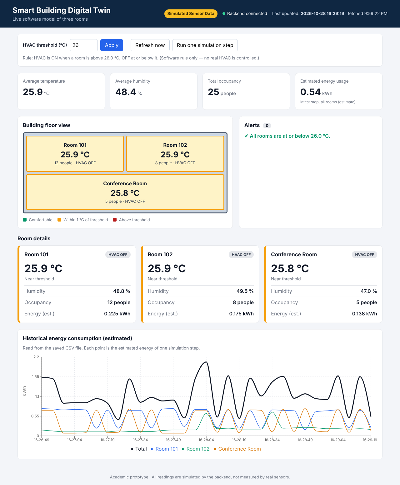

# Smart Building Digital Twin

A software-only prototype of a **digital twin** of a small building (three rooms). A Python/Flask backend generates **simulated** sensor readings, applies a rule-based HVAC control, saves history to a CSV file and exposes everything as a REST API. A React dashboard displays the live state, alerts and a historical energy chart.

> **All data is simulated.** There are no physical sensors, no IoT hardware and no real building data. The dashboard shows a "Simulated Sensor Data" notice, and the API reports `"data_source": "simulated"`. The HVAC "control" is a software rule only; no real HVAC equipment is controlled.



---

## 1. Project overview and objectives

**Overview.** The system keeps a virtual model (the "twin") of three rooms: Room 101, Room 102 and a Conference Room. The model updates every 5 seconds with simulated temperature, humidity, occupancy, HVAC status and energy estimates, and the dashboard mirrors that state.

**Objectives**

1. Simulate realistic, configurable sensor readings for three rooms.
2. Apply a configurable rule-based HVAC control (default threshold 26 °C).
3. Store readings with timestamps in CSV files.
4. Provide a documented REST API returning JSON.
5. Present the state, alerts and history in a responsive React dashboard.
6. Verify the logic and API with automated tests.

## 2. Problem statement

Facility managers often cannot see what is happening inside every room of a building, so overheating, wasted energy and equipment misuse go unnoticed. A digital twin gives a live, data-driven view of the building and lets control rules be tested safely. This project builds a low-cost software prototype of that idea, using simulated data so it can be developed and demonstrated without hardware.

## 3. System architecture

```
┌────────────────────┐   JSON over HTTP (REST)   ┌──────────────────────────────┐
│  React dashboard   │ ────────────────────────► │  Flask backend (app.py)      │
│  (Vite, port 5173) │ ◄──────────────────────── │  port 5001                   │
│  polls every 5 s   │                           │                              │
└────────────────────┘                           │  ┌────────────────────────┐  │
                                                 │  │ simulator.py           │  │
                                                 │  │  - random readings     │  │
                                                 │  │  - HVAC rule (pure)    │  │
                                                 │  └───────────┬────────────┘  │
                                                 │  ┌───────────▼────────────┐  │
                                                 │  │ storage.py (CSV)       │  │
                                                 │  └───────────┬────────────┘  │
                                                 └──────────────┼───────────────┘
                                                                ▼
                                                  data/sensor_readings.csv
```

| File | Responsibility |
|---|---|
| `backend/simulator.py` | Room definitions, random reading generator, **deterministic** HVAC rule, energy estimate, config validation, `SimulationState` |
| `backend/storage.py` | Appending and reading the CSV file, tolerant of missing, empty or damaged files |
| `backend/app.py` | Flask app, REST endpoints, JSON errors, CORS, background simulation thread |
| `frontend/src/services/api.js` | All HTTP calls to the backend |
| `frontend/src/components/` | Header, summary cards, room cards, floor view, alert panel, energy chart, controls |

## 4. Technology stack and justification

| Technology | Why it was chosen |
|---|---|
| **Python + Flask** | Simple, readable, well suited to a small REST API; matches the Python knowledge needed for the project |
| **flask-cors** | Lets the browser app on port 5173 call the API on port 5001 |
| **React + Vite** | Component-based UI; Vite gives a fast dev server and simple configuration |
| **Recharts** | Declarative React charts, minimal code for a line chart |
| **CSV storage** | Human-readable, no database server, easy to open in Excel to verify data |
| **pytest** | Concise tests and easy parametrisation |

## 5. Data flow (simulator → backend → frontend)

1. When the backend starts, it loads the latest saved readings from the CSV. If the CSV is missing or empty, it generates 30 past steps so the dashboard is not empty.
2. A **single background thread** calls `SimulationState.step()` every `interval_seconds` (5 s). For each room it produces a new reading from the previous one (random walk with HVAC cooling).
3. The HVAC status is decided by `decide_hvac(temperature, threshold)`.
4. The readings are appended to `data/sensor_readings.csv`.
5. The React app calls `GET /api/rooms` and `GET /api/history` every 5 seconds.
6. React stores the JSON in state and re-renders the summary cards, room cards, floor view, alerts and chart.

**Simulation model (short).** Occupancy changes by a small random amount each step. With HVAC OFF, temperature drifts toward the room's ambient temperature plus extra heat per person. With HVAC ON, it drops by 0.5 °C per step. Humidity drifts toward a target that rises with occupancy and falls when HVAC is on. Energy is `(0.3 kW base + 0.05 kW × people + HVAC kW if ON) × 0.25 h` per step, where each step represents 15 simulated minutes. These constants are assumptions, not measurements.

## 6. Folder structure

```
smart-building-digital-twin/
├── backend/
│   ├── app.py
│   ├── simulator.py
│   ├── storage.py
│   ├── requirements.txt
│   └── tests/
│       ├── conftest.py
│       ├── test_api.py
│       ├── test_logic.py
│       └── test_storage.py
├── frontend/
│   ├── package.json
│   ├── vite.config.js
│   ├── index.html
│   ├── .env.example
│   └── src/
│       ├── main.jsx
│       ├── App.jsx
│       ├── components/   (Header, SummaryCards, RoomCard, BuildingMap, AlertPanel, EnergyChart, Controls)
│       ├── services/     (api.js, helpers.js)
│       └── styles/       (index.css, App.css)
├── data/                 (sensor_readings.csv is created here on first run)
├── docs/                 (dashboard.png)
├── DEMO_GUIDE.md
├── VIVA_QA.md
└── README.md
```

## 7. Installation and setup

**Requirements:** Python 3.10+ and Node.js 18+ (it was built and tested with Python 3.13 and Node 22).

You need **two terminals**: Terminal 1 for the backend and Terminal 2 for the frontend.

### Terminal 1 – backend

```bash
cd smart-building-digital-twin/backend
python -m venv venv

# Activate the virtual environment
#   Windows (Command Prompt / PowerShell):  venv\Scripts\activate
#   macOS / Linux:                          source venv/bin/activate

pip install -r requirements.txt
python app.py
```

The backend runs on **http://127.0.0.1:5001**. Leave this terminal open. On first run it creates `data/sensor_readings.csv`.

### Terminal 2 – frontend

```bash
cd smart-building-digital-twin/frontend
npm install
npm run dev
```

Open **http://localhost:5173** in your browser.

If your backend is on a different address, copy `frontend/.env.example` to `frontend/.env` and edit `VITE_API_BASE_URL`.

### Terminal 3 (optional) – tests

```bash
cd smart-building-digital-twin/backend
# virtual environment activated, as above
python -m pytest -v
```

## 8. API documentation

Base URL: `http://127.0.0.1:5001`. Every response uses one format:

```json
{ "success": true,  "data": { } }
{ "success": false, "error": { "code": "INVALID_CONFIG", "message": "..." } }
```

### `GET /api/health`
```json
{ "success": true, "data": { "status": "ok", "service": "smart-building-digital-twin",
  "data_source": "simulated", "server_time": "2026-10-28T16:27:19" } }
```

### `GET /api/rooms`
Latest reading per room, a building summary and the current threshold.
```json
{ "success": true, "data": {
  "rooms": [
    { "room_id": "room-101", "room_name": "Room 101", "timestamp": "2026-10-28T16:27:16",
      "temperature_c": 25.7, "humidity_pct": 48.8, "occupancy": 16,
      "hvac_status": "OFF", "energy_kwh": 0.275, "exceeds_threshold": false },
    { "room_id": "conference-room", "room_name": "Conference Room", "timestamp": "2026-10-28T16:27:16",
      "temperature_c": 26.3, "humidity_pct": 47.3, "occupancy": 5,
      "hvac_status": "ON", "energy_kwh": 0.762, "exceeds_threshold": true }
  ],
  "summary": { "average_temperature_c": 25.9, "average_humidity_pct": 48.9,
               "total_occupancy": 33, "total_energy_kwh": 1.262, "rooms_with_hvac_on": 1 },
  "temperature_threshold_c": 26.0,
  "last_updated": "2026-10-28T16:27:16",
  "data_source": "simulated" } }
```
(The `rooms` array is shortened here; the real response contains all three rooms.)

### `GET /api/history?limit=60&room_id=room-101`
`limit` = number of recent time points (1–1000, default 60). `room_id` is optional. Returns raw readings and an energy series for the chart.
```json
{ "success": true, "data": { "count": 180,
  "readings": [ { "timestamp": "...", "room_id": "room-101", "...": "..." } ],
  "energy_series": [ { "timestamp": "2026-10-28T16:27:16", "total_energy_kwh": 1.262,
                       "by_room": { "room-101": 0.275, "room-102": 0.225, "conference-room": 0.762 } } ] } }
```
Errors: `400 INVALID_LIMIT`, `404 UNKNOWN_ROOM`.

### `POST /api/simulation/step`
Runs one (or several) simulation cycles immediately and saves them. Optional body: `{"steps": 3}` (1–50). Returns the same payload as `/api/rooms` plus `steps_run`, with status `201`. Errors: `400 INVALID_STEPS`, `400 INVALID_JSON`.

### `GET /api/config`
```json
{ "success": true, "data": {
  "config": { "temperature_threshold_c": 26.0, "interval_seconds": 5,
              "simulated_minutes_per_step": 15, "temperature_min_c": 18.0, "temperature_max_c": 34.0,
              "humidity_min_pct": 30.0, "humidity_max_pct": 70.0,
              "cooling_rate_c": 0.5, "temperature_noise_c": 0.3 },
  "rooms": [ { "id": "room-101", "name": "Room 101", "max_occupancy": 30 } ],
  "data_source": "simulated" } }
```

### `PUT /api/config` (added for the demo)
Body: `{"temperature_threshold_c": 24}` (15–40 °C) and/or `{"interval_seconds": 10}` (1–3600). Changing the threshold immediately re-evaluates HVAC status of the latest readings. Unknown keys, wrong types and out-of-range values return `400 INVALID_CONFIG`.

Unknown routes return JSON `404`; wrong methods return JSON `405`.

### Quick checks with curl
```bash
curl http://127.0.0.1:5001/api/health
curl http://127.0.0.1:5001/api/rooms
curl -X POST http://127.0.0.1:5001/api/simulation/step
curl -X PUT -H "Content-Type: application/json" -d '{"temperature_threshold_c": 24}' http://127.0.0.1:5001/api/config
curl -X PUT -H "Content-Type: application/json" -d '{"temperature_threshold_c": 500}' http://127.0.0.1:5001/api/config
```
On Windows Command Prompt, use `curl.exe` and escape the quotes as `"{\"temperature_threshold_c\": 24}"`, or use the browser for the GET endpoints.

## 9. Testing

Run from `backend/` with the virtual environment active:

```bash
python -m pytest -v
```

**What the tests cover (48 test cases in 3 files)**

- HVAC ON above the threshold, OFF below it, OFF exactly at the threshold, custom thresholds.
- Energy estimate (exact value and ON > OFF).
- Config validation (wrong type, booleans, out-of-range, unknown keys, empty body).
- `/api/health`, `/api/rooms` (3 expected rooms, fields, types, HVAC matches rule).
- `/api/history` (limit, invalid limit, unknown room, room filter, seed data).
- `/api/simulation/step` (adds 3 rows per step, multiple steps, invalid `steps`).
- `PUT /api/config` (threshold change updates rooms, invalid values rejected).
- CSV storage (missing file, empty file, damaged rows skipped, grouping and summing, restart without duplicate seed data).
- The background loop starts only once.

Random behaviour is separated from the rules: the HVAC rule is a pure function, and the random simulator accepts a seeded `random.Random`, so tests are repeatable.

**Actual results (executed during development in a Linux environment, Python 3.13.18, pytest 9.2.0):**

```
============================== 48 passed in 0.19s ==============================
```

**Other checks that were actually performed in that environment**

- Real backend started with `python app.py`: `/api/health` and `/api/rooms` answered, the CSV grew as the background loop ran (30 seed steps + live steps), and the response included the CORS header for `http://localhost:5173`.
- `npm run build` for the frontend completed successfully.
- With both servers running, an automated headless Chromium session confirmed: dashboard sections render, 3 room cards and the chart lines appear, setting the threshold to 15 gives 3 alerts and 3 HVAC-ON badges, an invalid threshold (99) shows the validation message, the "last updated" value changes by itself, and stopping the backend shows the error banner while keeping the last data on screen.

**Not tested:** Windows and macOS, browsers other than Chromium, long-running (hours) operation, and the React code has no unit tests of its own.

## 10. Sample simulation scenarios

| # | Scenario | Steps | Expected behaviour |
|---|---|---|---|
| 1 | Normal operation | Open dashboard, wait 15 s | Values change every 5 s; temperatures hover around 25–27 °C; HVAC switches ON when a room is just above 26 °C and OFF after it cools |
| 2 | Force alerts | Set threshold to 15 °C, press **Apply** | All rooms exceed it: 3 alerts, 3 × "HVAC ON", floor view turns red |
| 3 | No HVAC needed | Set threshold to 35 °C | No alerts, all "HVAC OFF", floor view green |
| 4 | Boundary rule | Unit test `decide_hvac(26.0, 26.0)` | Returns `OFF` (at the threshold = OFF) |
| 5 | Manual stepping | Press **Run one simulation step** | A new reading appears immediately; 3 rows are added to the CSV |
| 6 | Bad input | Enter 99 as the threshold | Error message: "temperature_threshold_c must be between 15.0 and 40.0." |
| 7 | Backend down | Stop Terminal 1 | Red banner, "Backend unavailable"; last data stays visible; recovers automatically when restarted |
| 8 | Persistence | Stop and restart the backend | Dashboard continues from the saved readings; no new seed data is added |

To start from scratch, stop the backend and delete `data/sensor_readings.csv`.

## 11. Known limitations

- All data is simulated; the model is simplified and not calibrated against any real building.
- Temperature of one room does not affect other rooms (no heat transfer or outdoor weather).
- The HVAC rule is a plain on/off threshold with no hysteresis, so it can switch ON/OFF every step near the threshold.
- Energy values are estimates from assumed power figures.
- CSV storage grows without limit and is read in full on each history request; it is not suited to large data.
- The configuration is kept in memory; changes to the threshold are not saved after a restart.
- Polling every 5 seconds is used instead of WebSockets.
- No authentication; the dev server (Flask development server) is not meant for production.
- Only two settings can be changed at run time; the room definitions are fixed in code.
- Recharts 2.x is used; npm prints a notice that the 2.x branch is no longer actively maintained.

## 12. Future enhancements

- Replace simulated values with real sensor data (for example via MQTT).
- Add hysteresis or a PID-style controller, and a schedule-based setpoint.
- Heat exchange between rooms and an outdoor-weather model.
- Use a database (SQLite/PostgreSQL) and persist configuration.
- WebSockets or Server-Sent Events for live push updates.
- A 3D or floor-plan model of a real building; more rooms and floors.
- User login and role-based access.
- Anomaly detection or energy forecasting (machine learning).
- Frontend unit tests and deployment with a production server (gunicorn + static hosting).
